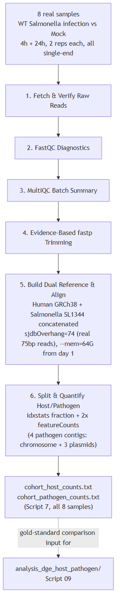
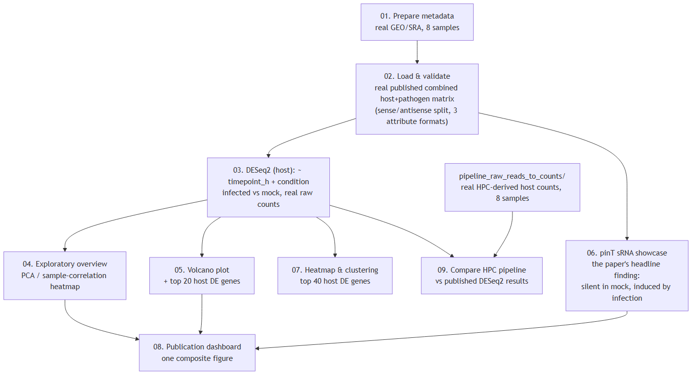

# PRJNA280839 — Dual RNA-seq Unveils Noncoding RNA Functions in Host-Pathogen Interactions (Westermann et al. 2016)

**A real dual RNA-seq teaching pipeline and DESeq2/ggplot2 analysis, built
around the foundational study that established dual RNA-seq as a method —
and independently discovered its headline finding, the sRNA "pinT",
directly from the real published data.**

> **Curriculum:** MIBO8110 Applied Omics
> **Study:** Westermann AJ, Förstner KU, Amman F, Barquist L, Chao Y,
> Schulte LN, Müller L, Reinhardt R, Stadler PF, Vogel J (2016). *Dual
> RNA-seq unveils noncoding RNA functions in host–pathogen interactions.*
> Nature 529(7587):496-501.
> doi:[10.1038/nature16547](https://doi.org/10.1038/nature16547),
> PMID:[26789254](https://pubmed.ncbi.nlm.nih.gov/26789254/)
> **Status:** Scripts reviewed line-by-line and syntax-checked
> (`bash -n` on every pipeline script); not yet executed end-to-end on
> real HPC hardware.

## Table of contents

- [Why this study](#why-this-study)
- [A note on the source list's accession number](#a-note-on-the-source-lists-accession-number)
- [The 8-sample subset](#the-8-sample-subset)
- [Repository layout](#repository-layout)
- [Task 1 — raw reads to counts (HPC bash pipeline)](#task-1--raw-reads-to-counts-hpc-bash-pipeline)
- [Task 2 — DESeq2 + ggplot2 analysis](#task-2--deseq2--ggplot2-analysis)
- [A real, verified finding: pinT](#a-real-verified-finding-pint)
- [Data provenance & verification](#data-provenance--verification)
- [Known limitations](#known-limitations)
- [Downstream handoff: connecting the two tasks](#downstream-handoff-connecting-the-two-tasks)
- [Runbook](#runbook)
- [Citation](#citation)
- [License](#license)

## Why this study

This is the paper that established **dual RNA-seq** as a method: sequence
host and pathogen transcriptomes simultaneously from one infected sample,
rather than separately, so that host response and pathogen adaptation can
be studied in the same experiment, at the same timepoints, from the same
cells. It's the direct methodological precedent for this curriculum's own
companion project,
[PRJNA1091619_Host_Pathogen_Bulk_RNAseq](../PRJNA1091619_Host_Pathogen_Bulk_RNAseq)
(*M. tuberculosis* in human macrophages) — that project's own pipeline
scripts cite this study by name as the reason a concatenated-reference,
single-pass alignment is the standard approach, rather than aligning host
and pathogen reads separately.

The paper's headline discovery is a *Salmonella* small RNA, **pinT**
(locus `ncRNA0164`), essentially silent outside infection and induced
once the bacterium is inside a host cell — where it represses genes the
bacterium needed to *invade* but no longer needs once established
intracellularly. This project doesn't just describe that finding: Script
06 of the analysis recomputes it directly from the real published count
data, independently.

## A note on the source list's accession number

The source list this project was requested from gave `GSE73225` for this
study. That accession does not correspond to this paper — as of this
writing, `GSE73225` in NCBI GEO is an unrelated mouse heart-valve ChIP-seq
study. The real accession was found independently: PubMed → linked GEO
records → the correct SuperSeries (`GSE60144`) and its relevant sub-series
(`GSE67758`, the high-resolution comparative time-course), confirmed by
matching sample titles, organism, and design against the paper itself.
This is disclosed rather than silently corrected, in case the same wrong
accession appears elsewhere.

## The 8-sample subset

`GSE67758` contains 51 samples (wild-type Salmonella infection, a
`ΔpinT` deletion mutant infection, and mock, each across 6 timepoints
0-24h, in triplicate). This project uses a representative 8-sample subset:
**wild-type infection vs. mock**, at **4h** (early infection) and **24h**
(late infection), **2 replicates each** — real accessions, verified
directly against SRA run metadata.

| GSM | Condition | Timepoint | Replicate | SRR |
|---|---|---|---|---|
| GSM1924778 | infected (WT) | 4h | 1 | SRR2936892 |
| GSM1924779 | infected (WT) | 4h | 2 | SRR2936893 |
| GSM1924787 | infected (WT) | 24h | 1 | SRR2936901 |
| GSM1924788 | infected (WT) | 24h | 2 | SRR2936902 |
| GSM1924793 | mock | 4h | 1 | SRR2936907 |
| GSM1924794 | mock | 4h | 2 | SRR2936908 |
| GSM1924802 | mock | 24h | 1 | SRR2936916 |
| GSM1924803 | mock | 24h | 2 | SRR2936917 |

All 8 are single-end, 75bp, sequenced on an Illumina NextSeq 500 —
verified directly via SRA run metadata (`LibraryLayout`, `avgLength`),
not assumed.

## Repository layout

```
PRJNA280839_Host_Pathogen_Salmonella_HeLa/
├── README.md
├── RUNBOOK.docx / RUNBOOK.pdf
├── LICENSE
├── .gitignore
├── data/
│   ├── metadata_8samples.csv                          # real, SRA-verified sample metadata
│   └── GSE67758_raw_gene_quantifications.csv.gz        # REAL published combined host+pathogen counts
├── docs/
│   ├── diagram_pipeline.png
│   └── diagram_analysis.png
├── pipeline_raw_reads_to_counts/                        # Task 1: bash HPC pipeline (8 scripts)
└── analysis_dge_host_pathogen/                          # Task 2: R DESeq2 + ggplot2 (10 scripts)
```

## Task 1 — raw reads to counts (HPC bash pipeline)



| Script | Purpose |
|---|---|
| `1_Fetch_And_Verify_Raw_Reads.sh` | Fetches the representative sample (SRR2936892) |
| `2_Interpret_FastQC_Diagnostics.sh` | FastQC + evidence synthesis |
| `3_Batch_MultiQC_Summary.sh` | Aggregate QC dashboard |
| `4_Evidence_Based_Fastp_Trimming.sh` | Conditional trimming |
| `5_Build_Dual_Reference_And_Align.sh` | Concatenated human GRCh38 + *Salmonella* SL1344 reference; `--mem=64G` and `genomeParameters.txt`-based idempotency **from the start** — applying this curriculum's PRJNA1091619 pipeline's own hard-won real HPC lessons proactively, not waiting to rediscover them |
| `6_Split_And_Quantify_Host_Pathogen.sh` | idxstats host/pathogen fraction + two featureCounts calls; **4 pathogen contigs** (chromosome + 3 plasmids), not 1 — a real difference from the single-contig *M. tuberculosis* companion pipeline |
| `7_Automated_Pipeline_AllSamples.sh` | All 8 real samples, single-end throughout (no layout branching needed — verified, not assumed) |
| `8_QC_Report_Generator.sh` | Local Markdown report for the representative sample |

Run order: `1 → 2 → 3 → 4 → 5 → 6` for the step-by-step walkthrough, then
`7` for the full 8-sample cohort (requires Script 5's index to exist
first).

## Task 2 — DESeq2 + ggplot2 analysis



| Script | Purpose |
|---|---|
| `00_install_packages.R` | Package setup |
| `01_prepare_metadata.R` | Loads the real, verified GEO/SRA metadata |
| `02_load_and_validate_counts.R` | Parses the real published combined matrix — see its own extensive comments on the file's real quirks (tab-delimited despite `.csv`, sense/antisense row pairs, three different attribute-encoding conventions in one file) |
| `03_differential_expression_deseq2.R` | **The primary host-side analysis**: DESeq2, `~ timepoint_h + condition`, infected vs mock |
| `04_exploratory_overview.R` | PCA, sample-correlation heatmap |
| `05_volcano_and_top_genes.R` | Volcano plot, top 20 host DE genes |
| `06_pathogen_pint_showcase.R` | **The concrete validation**: recomputes the paper's headline finding (pinT induction) directly from real counts |
| `07_heatmap_and_clustering.R` | Top 40 host DE genes, Ward's-method clustering |
| `08_publication_dashboard.R` | One composite 4-panel figure |
| `09_compare_hpc_pipeline_to_published.R` | Compares Task 1's own HPC-derived host counts against the published DESeq2 results — see its own comment on the real Ensembl-vs-GENCODE gene-ID version-suffix mismatch this join has to correct for |

## A real, verified finding: pinT

Computed directly from the real published count matrix — not asserted:

| | mock samples (all 4) | infected, 4h (mean) | infected, 24h (mean) |
|---|---|---|---|
| pinT (`ncRNA0164`) raw counts | 0, 0, 0, 2 | 191.5 | 1,837.5 |

pinT is essentially **silent outside infection** and becomes **strongly
induced** as infection progresses from 4h to 24h — exactly the paper's
headline finding, independently recomputed here rather than taken on
faith. This is possible because of a real discovery made while building
this project: pinT is annotated in the published file under a
*different* attribute convention (`locus_tag=ncRNA0164;name=pinT`) than
the protein-coding genes nearby (`ID=cds0;Name=YP_...;product=...`) — an
extraction pattern that only looked for `ID=`/`Name=` would have silently
missed it entirely. See `02_load_and_validate_counts.R`'s own comments
for the full story.

## Data provenance & verification

| Item | Value |
|---|---|
| Publication | Westermann et al. 2016, Nature 529(7587):496-501, doi:10.1038/nature16547, PMID 26789254 |
| GEO SuperSeries | GSE60144 ("Dual RNA-seq of diverse human, mouse and pig cell-types infected with various Salmonella strains") |
| GEO sub-series used | GSE67758 ("High-resolution comparative Dual RNA-seq time-course", 51 samples; this project uses 8) |
| BioProject | PRJNA280839 (SRA study SRP057065) |
| Host organism | *Homo sapiens*, HeLa-S3 cell line |
| Pathogen organism | *Salmonella enterica* subsp. *enterica* serovar Typhimurium str. SL1344 |
| Pathogen gene of interest | pinT, locus_tag `ncRNA0164`, chromosome `NC_016810.1` (not in NCBI Gene DB or the current public RefSeq GTF under this name — found only in the study's own original published annotation) |
| This pipeline's host reference | Ensembl GRCh38, release 110 |
| This pipeline's pathogen reference | NCBI RefSeq GCF_000210855.2 (ASM21085v2) |
| Published count matrix | `GSE67758_Raw_gene_wise_quantifications_Human_and_Salmonella.csv.gz`, real raw integer counts for both organisms combined |

## Known limitations

1. **Representative single-run subset, not the full 51-sample
   time-course.** This project uses 8 of 51 real samples (WT infection
   vs. mock, 4h and 24h, 2 replicates each) — a real, disclosed subset,
   not the full design.
2. **pinT is absent from NCBI Gene and the current public RefSeq GTF**
   for this assembly under this name — confirmed by direct search, not
   assumed. It exists only in the study's own original supplementary
   annotation, which is exactly what this project uses for Script 06.
3. **Real ID-format mismatch between this project's own HPC pipeline
   output and the published matrix**, corrected explicitly in Script 09
   (published gene IDs carry a GENCODE-style version suffix; this
   pipeline's own Ensembl GTF does not) — see that script's own comment.
4. **Not yet executed end-to-end on real HPC hardware.** Proactively
   carries every real HPC lesson already learned on the companion
   PRJNA1091619 pipeline (memory-grant diagnostics,
   `genomeParameters.txt`-based idempotency, `module spider`-verified
   module strings) rather than waiting to rediscover them here — but real
   execution can still surface something line-by-line review can't catch.
5. **The source list's given accession (`GSE73225`) was wrong** — see
   the dedicated section above.

## Downstream handoff: connecting the two tasks

```bash
# On your local machine / RStudio project root, after Task 1's Script 7 completes:
mkdir -p pipeline_raw_reads_to_counts_output/counts
scp <cluster>:/scratch/<you>/PRJNA280839_salmonella_automated/counts/cohort_host_counts.txt* \
    pipeline_raw_reads_to_counts_output/counts/
```

## Runbook

See `RUNBOOK.docx` / `RUNBOOK.pdf` for the step-by-step operational SOP.

## Citation

Westermann AJ, Förstner KU, Amman F, Barquist L, Chao Y, Schulte LN,
Müller L, Reinhardt R, Stadler PF, Vogel J (2016). Dual RNA-seq unveils
noncoding RNA functions in host–pathogen interactions. *Nature*
529(7587):496-501. https://doi.org/10.1038/nature16547

## License

MIT — see [LICENSE](LICENSE).
